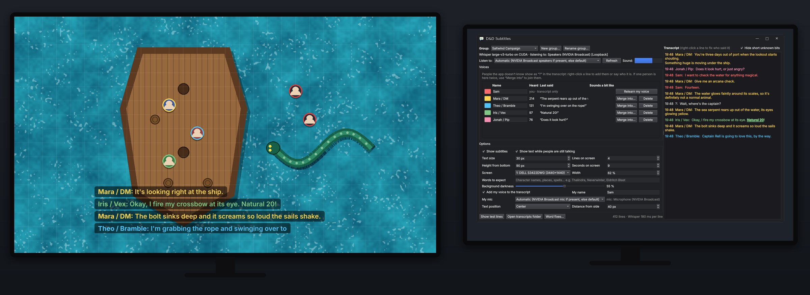

# D&D Subtitles

Live subtitles for Discord voice calls, made for tabletop sessions where people are hard to hear over bad mics.
At the bottom of the screen it shows **`Name: what they said`**, the whole line in that person's colour. A side
transcript keeps the whole session, saved per group and per day.

Everything runs locally on your PC. Nothing is sent anywhere, and no audio is stored.

- **Speech to text:** OpenAI Whisper *large-v3-turbo* via faster-whisper, on the GPU (CUDA).
- **Who is talking:** NVIDIA TitaNet voice fingerprints via sherpa-onnx, on the CPU.
- **When someone is talking:** Silero VAD.
- **Windows:** PySide6 (Qt). Audio is captured with WASAPI loopback (PyAudioWPatch).

## Install (Windows, NVIDIA GPU)
Double-click `install.bat`. It installs `uv` if needed and creates a Python 3.11 environment in `.venv`. Then it downloads the packages, the CUDA libraries and the models (Whisper is about 1.6 GB). It runs a test on a recorded sample call and puts a **D&D Subtitles** icon on the desktop.

## Use
Start it from the desktop icon (no console window; messages go to `app.log`). Closing the **D&D Subtitles** window quits.

- **System audio / My mic:** side by side at the top. System audio is the playback device Discord plays through; the lists refresh every time you open them. "Automatic" picks *Speakers (NVIDIA Broadcast)* if it exists, otherwise your default output (same idea for the mic). Watch the **Sound** bar: it should move while people talk.
  - If Discord outputs into a virtual cable (for example VB-Audio *CABLE Input*), pick that cable's recording side instead: *CABLE Output … (recording device)*.
- **Voices:** people the app doesn't know show as **?**. Right-click a line in the transcript and pick
  - **Add as new voice…** to name them;
  - **This is ▸ name** to say who it was. This also teaches the app, so it gets better with every correction;
  - **Merge "X" into ▸** if one person ended up as two voices, for example the DM's character voices.

  Click a colour box to change a colour.
- **Groups:** each D&D group has its own voices (`groups\<group>.json`). Switch, add or rename groups at the top of the window. Your own voice is shared by all groups.
- **Your own voice:** your mic is added to the transcript only, never to the subtitles. It is labelled with your Windows user name; change it under **My name**. Echo of the call that your mic picks up is recognised and ignored. Use **Relearn my voice** if your lines look wrong. Untick **My mic** (top row) when nobody on your side needs recording, such as a film or a stream: the mic picker, your name and your row in the voice list disappear and the mic is not opened.
- **Play a test run:** plays a made-up conversation on the subtitles (one-liners, quick back-and-forth, long speeches) with three test speakers, so you can set size, width, position and darkness. It only touches the overlay: no transcript, no saved voices. Press it again to stop.
- **Change models…** (top row): pick the speech model, the spoken languages (tick several if people switch; German, Spanish, French, Italian, Portuguese and Dutch are available besides English) and the voice model. Each option says what it needs: for example *Large v3 turbo* needs an NVIDIA graphics card, *Small* runs on any computer. The window shows what was found on your computer and marks the recommended choice. A changed model is downloaded first; the old one is deleted when the app restarts. Changing only the languages applies at once. Changing the voice model sets the saved voices aside, because they only fit the model that made them. The installer picks the recommended models by itself (no CUDA download without an NVIDIA card).
- **Check for updates:** asks GitHub whether there is a newer version and, if so, asks before downloading it. Only program files are replaced; settings, voices, transcripts and models stay. A git clone is updated with `git pull`, anything else by downloading the files. If the setup changed it tells you to run `install.bat` again.
- **Transcripts:** saved in `transcripts\<group>\<date>_<time>.txt` (for example `2026-10-19_01-45.txt`). If you reopen the app within 5 minutes it carries on in the same file. Between 5 minutes and an hour it asks "Is this a continuation of the previous session from …?". After an hour it starts a new file. Fixes and renames are written into the file too. Select lines with Ctrl or Shift-click and copy them with right-click or Ctrl+C. "Natural 20" is highlighted.
- **Keep transcript:** untick it and nothing is written to a file; the transcript window only shows the last minute.
- **Word fixing** (three lists, saved per group, from lowest to highest impact):
  - **Manual word swap (low impact):** always change one exact heard word or phrase into another, for example *straw → Strahd*. Runs first.
  - **Automatic word swap (medium impact):** a list of names and terms. Anything that looks or sounds close is changed into them by itself (*bee holder → Beholder*, *fire ball → Fireball*). Ordinary and very short words are left alone, and long lists are fine.
  - **Words to expect (high impact, capped at 40):** names Whisper listens for while it transcribes. The strongest help, but only about 40 fit, so put the most important first.
- **Display:** text size and width, number of lines, how long lines stay, screen, background darkness, and position. Position is two sliders in pixels, **Horizontal offset** and **Vertical offset**, which you can also type into; 0 and 0 is centred near the bottom, negative moves left/up, positive moves right/down. The window stays click-through over games; use borderless or windowed mode.

## How it works (short)
1. Audio from the call is cut into stretches of speech. Each stretch is transcribed by Whisper. While someone is still talking, a quick partial transcript is shown first; words that two guesses in a row agree on are locked in.
2. Each stretch gets voice fingerprints. If the voice changes mid-stretch (someone jumps in), it is split at that point, even while they are still talking. This is checked a few times a second: a quick check on the last couple of seconds, and a scan of the whole stretch so a change is found however long ago it happened.
3. Fingerprints are matched against the group's saved voices. Confident matches refine that voice. Short or uncertain bits stay **?**.
4. Mic lines are compared with what the call was playing at the same moment. Audio that rises and falls with the call is echo and is dropped.

## Files
| file | what |
|---|---|
| `app.py` | windows: subtitle overlay, control window, transcript |
| `wordswap.py` | the automatic word swap (`python tools\test_wordswap.py` checks it) |
| `engine.py` | audio capture, speech detection, Whisper, voice matching, echo filter |
| `install.bat` / `install.ps1` | setup |
| `updater.py` | the Check for updates button |
| `models.py` | the model list, what each needs, download and delete (`python models.py` shows what this computer gets) |
| `Subtitles.bat` | start without the desktop icon |
| `make_shortcut.ps1` | (re)create the desktop icon |
| `selftest.py` | runs a recorded call through the engine and scores who-said-what: `selftest.bat test\conversation.flac --truth test\conversation.json` |
| `echotest.py` | checks your mic lines are kept and the call's echo is not: `echotest.py test\call2.flac test\mic.flac test\mic.json` |
| `audiotest.py` | lists what the app can listen to and records a few seconds from one (`audiotest.py "rec:CABLE Output"`, `audiotest.py mic`) |
| `test\` | synthetic test calls made with computer voices (no real people) |
| `tools\` | scripts that made the test calls, and `speaker_latency.py` (how fast a new speaker is noticed) and `whisper_eval.py` + `eval_video.bat` (check Whisper against a video's human-made captions) |

Personal data (`groups\`, `my_voice.json`, `transcripts\`, `config.json`, `app.log`) is kept out of git by `.gitignore`.
